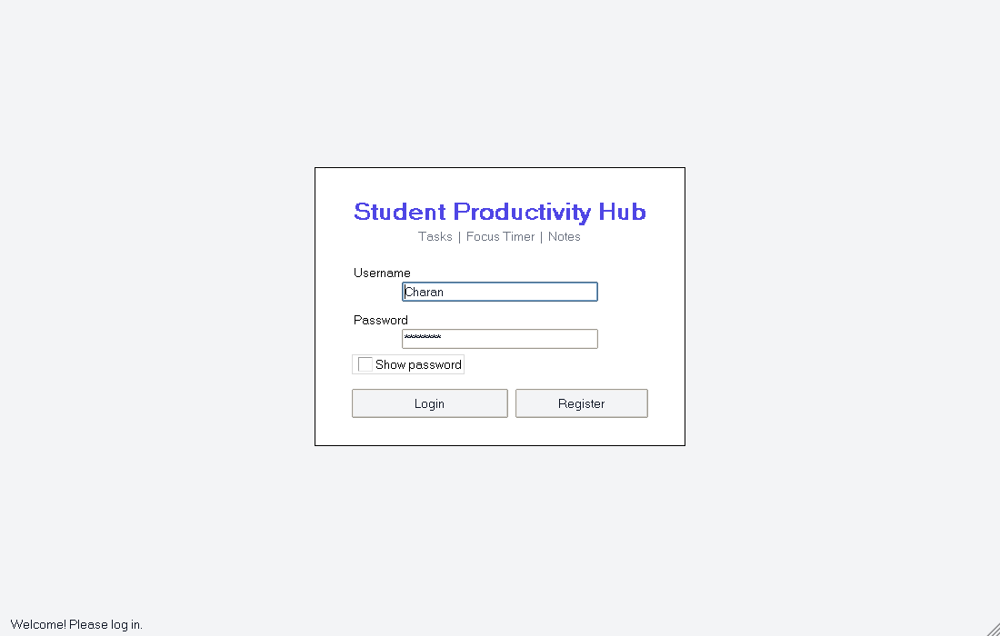
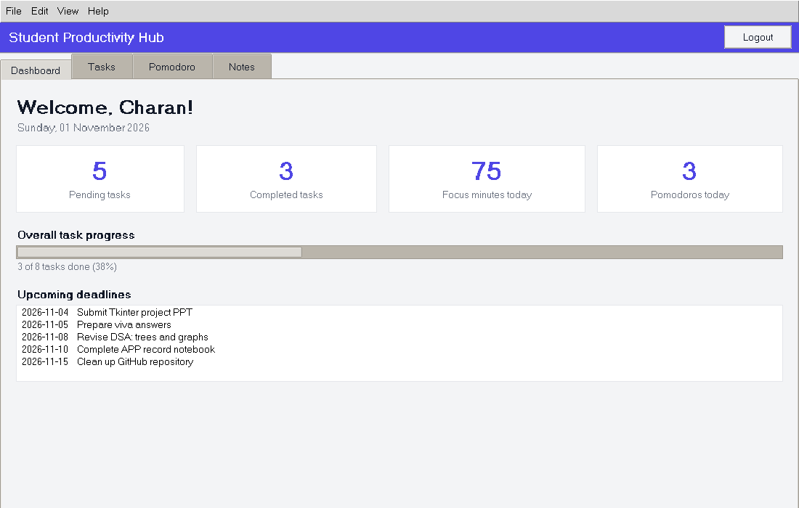
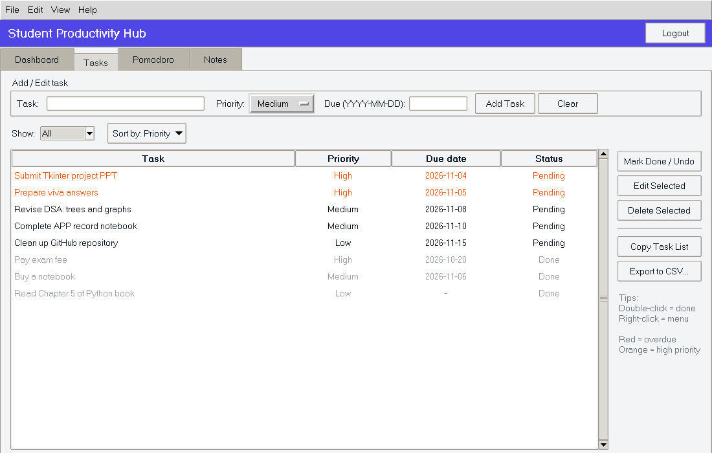
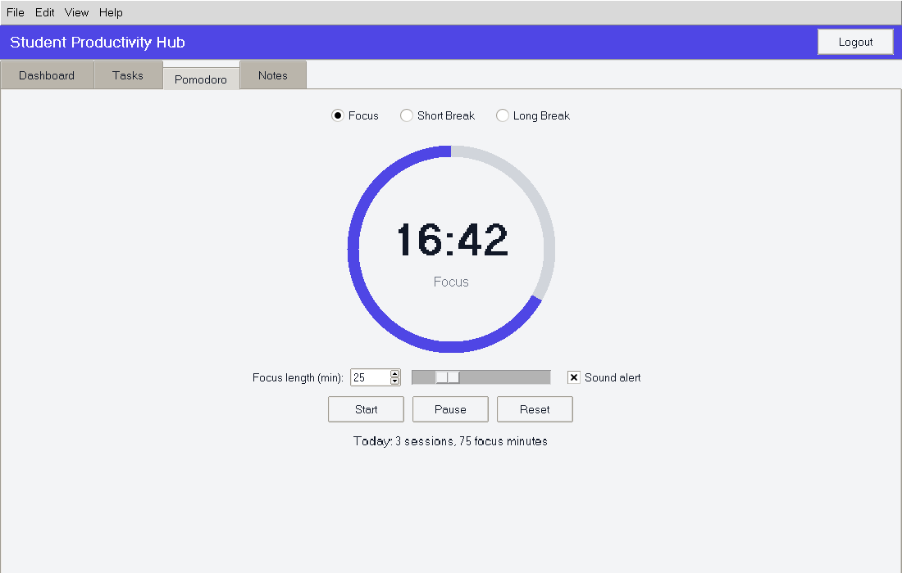
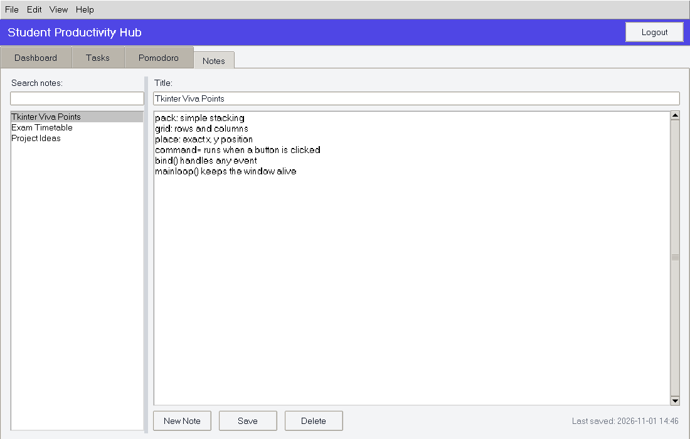
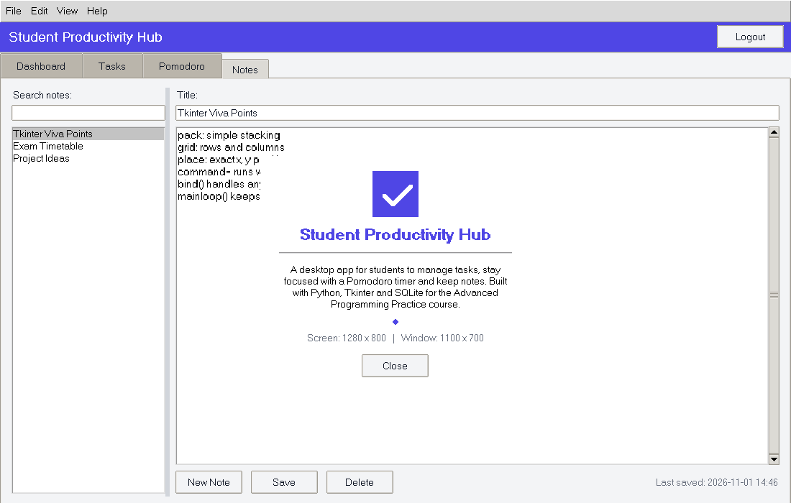

# Student Productivity Hub

A desktop app built with **Python Tkinter** and **SQLite** for the *Advanced Programming Practice* course at SRMIST, Kattankulathur.

Author: H. Charan Tej

It brings three tools into one window:

- **Tasks**: add, edit, delete and search tasks with priority and due date, and export to CSV.
- **Pomodoro timer**: focus and break sessions with a Canvas ring and progress bar.
- **Notes**: write, save and search notes, with clipboard support.

Accounts are stored in a local SQLite database. Passwords are salted and hashed (PBKDF2-HMAC-SHA256) and usernames are unique.

## Run it

Requires Python 3.8+ with Tkinter (included with the standard Windows and macOS installers).

```bash
python main.py
```

The database file `productivity_hub.db` is created automatically on first run.

## Files

| File | Purpose |
|------|---------|
| `main.py` | All screens: login, dashboard, tasks, Pomodoro, notes, About window |
| `database.py` | SQLite data layer: users, tasks, notes, sessions |

## Tkinter concepts covered

Label, Button, Entry, Text, Checkbutton, Radiobutton, Listbox, Scrollbar, Canvas, Scale, Spinbox, Message, OptionMenu, ttk Treeview, Notebook, Progressbar, Combobox, Menubutton, LabelFrame, Separator, Sizegrip, PanedWindow, Toplevel, menus, dialogs, events and `bind`, `after()`, `winfo_*`, images, clipboard, and Tkinter variables.

## Screenshots

| Login | Dashboard |
|---|---|
|  |  |
|  |  |
|  |  |
